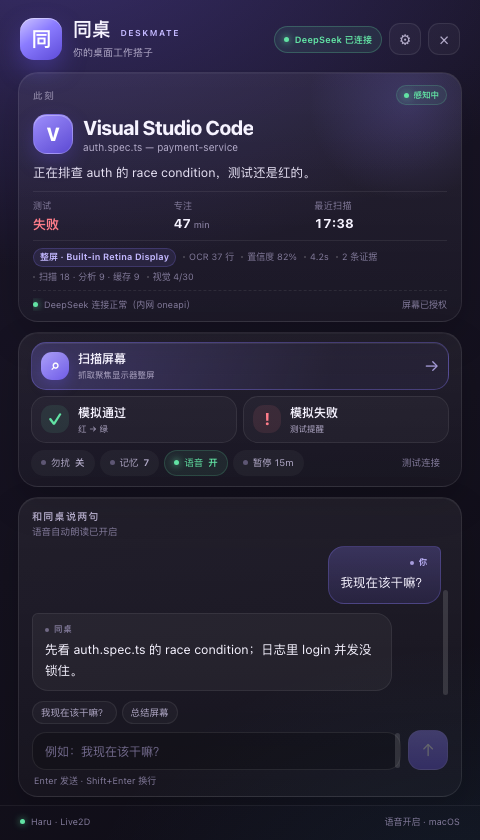

# DeskMate / 同桌

> 一个坐在 macOS 屏幕边上的独立 AI 工作搭子：自己看屏幕、自己判断、自己说话。**不依赖 VS Code，不依赖任何 IDE 插件。**

当前状态：**独立 macOS 原型已经搭好**。Electron 透明窗 + Haru Live2D + 屏幕/前台窗口感知 + 本地 Vision OCR + DeepSeek 视觉 + SQLite 长期记忆 + 工具调用 + 隐私/预算/勿扰 + 面板 UI。内网 oneapi 已实测通过。
还没接 macOS Speech 语音输入、`say` WAV 口型驱动和 DMG 打包。

## 架构

```text
macOS 本机
├─ Electron 主进程
│  ├─ 前台窗口：get-windows
│  ├─ 屏幕截图：当前聚焦显示器整屏（desktopCapturer，按需 + 自动）
│  ├─ 本地 OCR：native/ocr（macOS Vision）
│  ├─ 记忆：SQLite + FTS5（node:sqlite）
│  ├─ 大脑：DeepSeek 文本 + 视觉 + JSON + tool calls
│  ├─ 事件桥：127.0.0.1:39876
│  └─ 主动策略：冷却 / 勿扰 / 视觉预算
├─ Live2D 透明窗：Haru
├─ 面板：状态 / 扫描 / 记忆 / 设置 / 聊天
└─ 语音：macOS say（Tingting）
```

> 透明桌面窗、屏幕录制、`say` 都必须在 macOS 本机；历史构建环境里的 Linux 服务器不参与最终运行。
> 屏幕截图只会发给 DeepSeek 做视觉分析，不经过其他服务器。

## 已确定

| 决策 | 选择 |
|---|---|
| 平台 | macOS |
| 桌面壳 | Electron + React + TypeScript |
| 形象 | Live2D，默认 **Haru**（Cubism 3/4） |
| 大脑 / 眼睛 | 百度内网 oneapi（OpenAI-compatible）：`DeepSeek-V4.1-Flash` 文本 + `DeepSeek-V4-Flash-Vision-Exp` 视觉 |
| 感知 | 前台窗口 + 当前显示器整屏 + 本地 OCR + 空闲时间；**无 VS Code 依赖** |
| 嘴巴 | macOS `say` |
| 耳朵 | macOS `SFSpeechRecognizer`（下一步） |
| 记忆 | SQLite + FTS5（已实现） |

## 运行

### 首次安装

```bash
bash scripts/macos-setup.sh
```

它会：

- 优先使用系统 Node；没有就把项目自带的 `.node/` 加进 PATH；
- 编译 `native/ocr`；
- 复制 `.env.example` 为 `.env.local`；
- `npm install`；
- `npm run typecheck`；
- `npm test`；
- `npm run build`。

然后编辑 `.env.local`，填入有效的 `DEEPSEEK_API_KEY`。

### 启动

```bash
bash scripts/dev.sh
```

`scripts/dev.sh` 会自动找到项目自带的 Node，所以即使 `node` 不在 PATH 里也能启动。
如果系统已经装了 Node 22+，也可以直接：

```bash
npm run dev
```

> `.env.local` 已被 `.gitignore` 忽略。不要把 key 提交到仓库。
> 没有有效 key 时，应用会自动使用本地 mock，不会崩。
> 打包后，`.env.local` 和 `config/avatar.haru.json` 也可以放在 `~/Library/Application Support/DeskMate/`。

### 构建与检查

```bash
npm run typecheck
npm test
npm run build
npm run check:model
```

### macOS 权限

首次运行会请求：

- **Screen Recording**：抓当前窗口截图；
- **Accessibility**：读前台窗口标题。

去“系统设置 → 隐私与安全性 → 屏幕录制 / 辅助功能”勾选 DeskMate（开发模式下可能显示为 Electron），然后重启应用。

## 现在能做什么



- 透明、置顶、可拖动、点击穿透的 Haru 桌面形象；
- 面板窗口（默认 480×840）：当前应用/窗口/活动、测试状态、屏幕权限、API 状态、聊天；
- **长期记忆**：SQLite + FTS5，保存在 `~/Library/Application Support/DeskMate/memory.db`；支持分类（项目/偏好/事实）、置顶、搜索、编辑、单条删除、手动添加；按问题检索相关记忆，并记录来源/置信度/使用次数；
- **自动记忆**：可开关；稳定的偏好/项目会从聊天中自动沉淀，相似记忆自动合并；关闭后只有明确说“记住”才写入；
- **工具调用**：`remember`、`search_memory`、`scan_screen`、`set_dnd`；
- **勿扰与主动策略**：面板可切换勿扰；自动提醒有 5 分钟冷却，连续专注 25 分钟或空闲 10 分钟才会主动关注；空闲/锁屏会重置专注计时；
- **扫描当前屏幕**：抓当前前台窗口所在显示器的整屏 → macOS Vision 本地 OCR → `DeepSeek-V4-Flash-Vision-Exp` 视觉 → 更新活动/测试状态；同屏出现隐私排除应用时自动退回到前台窗口截图；
- **可信感知**：截图感知哈希 + OCR 行相似度去重；面板显示 OCR 行数、置信度、耗时、证据数和扫描/分析/缓存次数；
- **自适应扫描**：默认 60 秒，窗口变化 12 秒内触发；未变化/空闲/面板收起时自动降频；可暂停感知 15 分钟；可通过 `DESKMATE_SCAN_INTERVAL_MS` / `DESKMATE_AUTO_SCAN=0` 调整；
- **隐私与成本**：可配置隐私排除应用（前台命中时不截图、不分析；整屏模式发现同屏可见的隐私应用时退回前台窗口）和每小时视觉预算（超限只用本地 OCR）；启动默认只显示 Haru，不自动弹出面板；
- **检测测试红→绿**：上一次截图是 fail、这次是 pass，就生成一句祝贺；
- DeepSeek 可用时走真实模型，key 缺失/无效时自动回退 mock；
- 托盘菜单、全局快捷键 `Cmd+Shift+Space` 打开/收起面板；
- 点击 Haru 或气泡打开面板；拖动 Haru 移动位置，位置跨重启保存；
- 聊天回复自动通过 `say` 朗读，并同步气泡/口型；新的语音会打断上一条；
- 本地事件桥 `POST http://127.0.0.1:39876/event`，可以用 `npm run demo:pass` / `npm run demo:fail` 手动触发；只接受 JSON Content-Type，并拒绝非本机 Origin。

## 还没做

- macOS Speech push-to-talk；
- `say` 输出 WAV → 振幅口型（当前是合成嘴型）；
- 语义/向量记忆检索（当前是 FTS5 + LIKE）；
- 真正的本地 AI 语音（当前是 macOS `say`）；
- DMG 打包、登录自启、代码签名；
- 多显示器贴边/吸附（当前可拖动并保存位置）；
- 多块显示器同时分析（当前一次只抓聚焦显示器整屏）。

## 目录

```text
assets/live2d/
├─ README.md                 # 模型选择与备选
├─ haru/                     # 默认 Live2D 模型（含 preview / README / 许可）
├─ LICENSE-Live2D-CubismWebSamples.md
└─ NOTICE-Live2D.md

config/
└─ avatar.haru.json          # Haru 的表情/动作/口型映射

native/
├─ ocr.swift                 # macOS Vision OCR 源码
└─ ocr                       # 本地编译产物（gitignore，setup 时重建）

src/
├─ main/
│  ├─ index.ts               # 窗口、托盘、快捷键、IPC、点击穿透、自动扫描
│  ├─ windows.ts             # Avatar / Panel 双窗口
│  ├─ brain.ts               # 状态、API/mock 回退、截图分析、红绿检测、主动策略
│  ├─ perception.ts          # 前台窗口 + 截图 + 空闲时间
│  ├─ ocr.ts                 # 调 native/ocr
│  ├─ memory.ts              # SQLite + FTS5 长期记忆
│  ├─ deepseek.ts            # 文本 + 视觉 + JSON + tool calls
│  ├─ mockBrain.ts           # 无 key/401 时的本地回退
│  ├─ persona.ts             # 角色 prompt
│  ├─ agentTools.ts          # 工具定义
│  ├─ eventBridge.ts         # 本地 HTTP 事件桥
│  ├─ env.ts                 # .env.local 读取
│  └─ tts.ts                 # macOS say
├─ preload/index.ts          # contextBridge API
├─ renderer/
│  ├─ AvatarApp.tsx          # 透明窗：Live2D + 气泡
│  ├─ PanelApp.tsx           # 面板：状态 / 扫描 / 记忆 / 设置 / 聊天
│  ├─ Live2DStage.tsx        # Pixi + pixi-live2d-display
│  ├─ Bubble.tsx
│  └─ styles.css
└─ shared/types.ts           # IPC 类型

scripts/
├─ dev.sh                    # 自动找 Node 后启动开发模式
├─ macos-setup.sh            # 安装、编译 OCR、检查、构建
├─ test-memory.mjs           # MemoryStore 单测（node:test）
├─ test-event-bridge.mjs     # 事件桥校验单测
├─ check-live2d-model.mjs    # 校验 model3.json 引用文件
└─ send-test-event.mjs       # 手动触发红绿事件
```

## 版本管理

仓库已经用 Git 维护，默认分支 `main`。当前是本地仓库，没有配置远程。

```bash
git log --oneline
git status
```

`.node/`、`node_modules/`、`out/`、`.env.local`、`native/ocr` 都不会进入仓库；`native/ocr` 由 `scripts/macos-setup.sh` 重建。

## 已知问题

- **内网 oneapi**：`https://oneapi-comate.baidu-int.com/v1`，需要公司网络/VPN。`/v1/models` 已返回 200；`DeepSeek-V4.1-Flash` 文本/JSON、`DeepSeek-V4-Flash-Vision-Exp` 识图、chat 都已实测通过。
- **屏幕扫描依赖权限**：macOS 没给 Screen Recording 时，`desktopCapturer` 返回空；面板会提示。
- **整屏截图会包含同屏其他窗口**：默认抓聚焦显示器整屏；如果同屏有隐私排除应用可见，会退回前台窗口截图。若希望始终只抓窗口，可以把 `captureFocusedDisplay()` 换回 `captureActiveWindow()`。
- **整屏隐私回退依赖 Accessibility**：没有辅助功能权限时，`get-windows` 读不到同屏窗口列表，只能保证前台应用被排除；授权后才会执行“同屏有隐私应用则退回窗口截图”。读取失败会在 4–5 秒后超时，不会卡死扫描。
- **自动扫描成本**：每 60 秒一张低细节图，每张最多约 1024 tokens；个人强度约几美元/月。
- **点击穿透依赖 hit rect**：如果 macOS 上点击不灵，需要把 `focusable` 在 hover 时临时设为 true（待真机验证）。
- **`node:sqlite` 仍带 experimental 警告**：Electron 45 / Node 24 下已实测可用；Node 22 启动时可能打印 SQLite experimental warning，不影响使用。
- **打包还没闭环**：仍缺 electron-builder/DMG 流程；代码已支持从 userData 读取 `.env.local` 和 `config/avatar.haru.json`，`native/ocr` 需要随应用放进 resources。
- **事件桥没有 token**：已经限制为本机 Origin + JSON Content-Type，但同机进程仍可调用；后续可以加一次性 token。

## 下一步

1. 在 Mac 上跑 `bash scripts/dev.sh`，确认屏幕扫描 + 视觉分析 + 气泡/语音。
2. 接 macOS Speech push-to-talk。
3. 接 `say` WAV + 振幅口型。
4. 加语义记忆检索。
5. 打包 DMG，登录自启，代码签名。
6. 给主动策略和感知去重补更多单测。

先跑通“看屏幕 → 判断 → 说一句”，再追求“好听、好看、好玩”。
