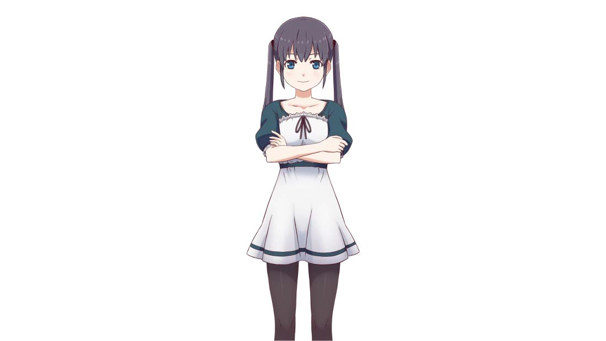

# Live2D 资产

## 默认：Haru



- 路径：`assets/live2d/haru/Haru.model3.json`
- 版本：Cubism 3/4（`Version: 3`）
- 特征：8 个表情、2 个 idle、4 个 `TapBody`、`ParamMouthOpenY` 口型
- 配置：`config/avatar.haru.json`
- 说明：[haru/README.md](haru/README.md)
- 许可：Live2D Free Material License；见 `LICENSE-Live2D-CubismWebSamples.md`

选它的原因：**Cubism 4 能直接用 `pixi-live2d-display`，有表情、有口型、有 hit area，体积小。**  
Hiyori 更软但没表情；Mao 更花哨但口型参数是 `ParamA`，要多做一层映射。Haru 是“安静、有点酷的同桌”，和 persona 最搭。

## 备选

| 模型 | 适合 | 注意 |
|---|---|---|
| Hiyori | 更邻家、idle 更多 | 没有表情，情绪反馈弱 |
| Mao | 更活泼/奇幻 | 口型参数 `ParamA`，需映射 |
| 自制/约稿 | 完全贴合角色 | 成本高，但最值得长期用 |

## 校验

```bash
node scripts/check-live2d-model.mjs assets/live2d/haru/Haru.model3.json
```

输出 `missing: []` 即文件完整。
